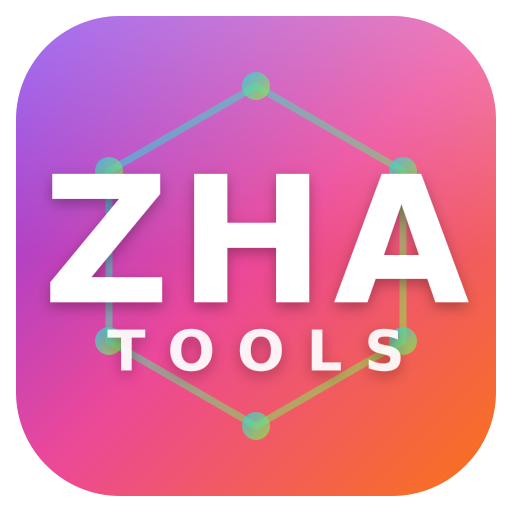

# ZHA Tools

<p align="center">
  
</p>

<p align="center">
  <a href="https://github.com/egenix/zha-tools/actions/workflows/ci.yml"></a>
  <a href="https://hacs.xyz"></a>
</p>

ZHA Tools is a [Home Assistant](https://www.home-assistant.io/) custom integration that provides a growing collection of small **helper actions** for working with [ZHA](https://www.home-assistant.io/integrations/zha/) (Zigbee Home Automation) devices from your automations and scripts.

Each helper is a self-contained action in the `zha_tools.` namespace that does one job and reports a clear result. The integration is built to be extended: new helpers can be added alongside the existing ones without changing how they are installed or used.

The helpers recover flaky Zigbee devices on a schedule, or in response to an event, without anyone having to walk over to the device — which matters because installed devices often have their pairing button buried behind a wall plate, ceiling fitting or enclosure.

## Helpers

| Helper | Action | What it does | Risk |
| --- | --- | --- | --- |
| [Reconfigure](#reconfigure) | `zha_tools.reconfigure` | Run a ZHA device reconfigure (re-run binding and reporting setup) with automatic retries. | Safe |
| [Re-interview](#re-interview) | `zha_tools.reinterview` | Re-interview a device in place (rediscover its endpoints and clusters) with automatic retries. The device never leaves the network. | Safe |
| [Ping](#ping) | `zha_tools.ping` | Check that a device answers, with automatic retries. Also brings back devices ZHA has given up on. | Safe |
| [Frame counter](#frame-counter) | `zha_tools.frame_counter` | Read the network frame counter the coordinator stores for a device, to track down frame counter failures. | Safe |
| [Query route](#query-route) | `zha_tools.query_route` | Report everything the coordinator knows about the route to a device, with each hop named. | Safe |
| [Retry action](#retry-action) | `zha_tools.retry_action` | Call any action, such as `climate.set_temperature` or `cover.close_cover`, again and again with a slow exponential backoff until the device acknowledges it. | Depends on the wrapped action — only wrap actions that can safely run more than once |
| [Rejoin](#rejoin) | `zha_tools.rejoin` | Ask a device to leave and immediately rejoin — a remote substitute for the pairing button. | ⚠️ Dangerous |

All actions report a status back to the caller. Capturing that response is optional; the examples in this document use `zha_response` as the standard name for the response variable (see [Response variable](#response-variable)). Every response also includes `device_name`, the device's display name in Home Assistant (the name you gave it, or else the device name; `null` if it has none).

Reconfigure, re-interview, ping, frame counter and query route also run on [all devices](#running-on-all-devices) at once, instead of on a single one.

More helpers will be added to this list over time.

## Requirements

- Home Assistant **2025.8.0** or newer.
- The ZHA integration must already be set up, with the device(s) you want to work with paired and managed by ZHA.
- [Re-interview](#re-interview) needs a ZHA version with in-place re-interviews (as shipped with current Home Assistant releases); on older versions the action fails with an error asking you to update.

All actions except [retry action](#retry-action) are **admin-only**: a non-admin user calling them gets an "unauthorized" error. Automations and scripts are not affected, as they don't run as a user. Retry action is open to everyone, because the wrapped action runs with the caller's own permissions.

## Installation

### HACS (recommended)

1. In HACS, add `https://github.com/egenix/zha-tools` as a custom repository with the category **Integration**.
2. Install the **ZHA Tools** integration from HACS.
3. Restart Home Assistant.
4. Add the integration via **Settings -> Devices & Services -> Add Integration**, then search for **ZHA Tools**.

### Manual

1. Copy the `custom_components/zha_tools` directory into your Home Assistant `config/custom_components/` directory.
2. Restart Home Assistant.
3. Add the integration via **Settings -> Devices & Services -> Add Integration**, then search for **ZHA Tools**.

The integration is set up entirely from the UI via Home Assistant's config and options flows; each helper's defaults (where it has any) are edited under **Settings -> Devices & Services -> ZHA Tools -> Configure**.

## Reconfigure

The `zha_tools.reconfigure` action triggers a ZHA device reconfigure for a single device — or for [all devices](#running-on-all-devices) — and reports the outcome back to the caller.

- Runs the reconfigure from automations and scripts, the same operation as the "Reconfigure device" button in the ZHA UI.
- Automatically retries when the reconfigure does not complete cleanly.
- Configurable per-attempt timeout, maximum number of retries, and delay between attempts — set sensible defaults once and override them per call.
- Returns structured response data (`device_id`, `status`, `attempts`) so automations can react to the outcome.

### Defaults

The defaults shared by reconfigure, re-interview and ping are edited via **Settings -> Devices & Services -> ZHA Tools -> Configure**:

- **timeout** (default `20`) — the per-attempt timeout, in seconds. A single reconfigure attempt that does not finish within this time is reported as a `timeout` and (if retries remain) retried.
- **max_retries** (default `10`) — the maximum number of retries *after* the first attempt. The total number of attempts is therefore up to `max_retries + 1`. A retry happens whenever the status is anything other than `complete`.
- **retry_delay** (default `5`) — the number of seconds to wait between attempts.

Each of these defaults can be overridden on a per-call basis by passing the corresponding field to the action.

### Fields

| Field | Required | Default | Description |
| --- | --- | --- | --- |
| `device_id` | yes, unless `all_devices` is used | — | The ZHA device to reconfigure. The UI presents a device selector filtered to the `zha` integration. |
| `all_devices` | no | `false` | Reconfigure every ZHA device except the coordinator, one after another. Cannot be combined with `device_id`. See [Running on all devices](#running-on-all-devices). |
| `timeout` | no | configured default (`20`) | Per-attempt timeout, in seconds. |
| `max_retries` | no | configured default (`10`) | Maximum number of retries after the first attempt (total attempts up to `max_retries + 1`). |
| `retry_delay` | no | configured default (`5`) | Seconds to wait between attempts. |

### Response

The action returns response data, which automations and scripts capture with `response_variable` (by convention `zha_response`). Capturing it is optional: a call without `response_variable` still runs the action, it just discards the result.

The response is a mapping with the following keys:

- `device_id` (string) — the ID of the device that was reconfigured.
- `device_name` (string or `null`) — the device's display name in Home Assistant.
- `status` (string) — one of:
  - `complete` — the reconfigure finished and at least one binding and at least one reporting configuration step were reported back as successful (a flaky device where only some clusters succeed still counts).
  - `incomplete` — the reconfigure finished, but it did not get at least one successful binding and one successful reporting step.
  - `timeout` — an attempt did not finish within the timeout.
  - `unavailable` — the device did not respond / is offline.
- `attempts` (integer) — the number of attempts that were made.

### Example: automation

This automation reconfigures a device every night and sends a notification with the result.

```yaml
alias: Nightly reconfigure of the kitchen sensor
triggers:
  - trigger: time
    at: "03:00:00"
actions:
  - action: zha_tools.reconfigure
    data:
      device_id: 1234567890abcdef1234567890abcdef
      timeout: 15
      max_retries: 5
      retry_delay: 10
    response_variable: zha_response
  - if:
      - condition: template
        value_template: "{{ zha_response.status == 'complete' }}"
    then:
      - action: notify.mobile_app_phone
        data:
          title: ZHA Tools
          message: "Device reconfigured successfully after {{ zha_response.attempts }} attempt(s)."
    else:
      - action: notify.mobile_app_phone
        data:
          title: ZHA Tools reconfigure failed
          message: "Reconfigure ended with status '{{ zha_response.status }}' after {{ zha_response.attempts }} attempt(s)."
```

### Example: script / Developer Tools

You can also call the action directly from a script, or from **Developer Tools -> Actions** (Perform action). When calling it programmatically, request the response so you can read the result.

```yaml
sequence:
  - action: zha_tools.reconfigure
    data:
      device_id: 1234567890abcdef1234567890abcdef
    response_variable: zha_response
  - action: system_log.write
    data:
      level: info
      message: "Reconfigure status={{ zha_response.status }} attempts={{ zha_response.attempts }}"
```

In **Developer Tools -> Actions**, select `zha_tools.reconfigure`, pick the device, and enable "return response" to see the `device_id`, `status`, and `attempts` returned by the call.

### How it works

When the action is called, it triggers a ZHA device reconfigure for the selected device and watches ZHA's progress events for the device — in particular the binding and configure-reporting steps. Based on those events it decides the outcome: `complete` when at least one binding and at least one reporting step succeeded, `incomplete` when the run finished without that minimum success, `timeout` when an attempt did not finish in time, and `unavailable` when the device did not respond. If the result is anything other than `complete`, the action waits `retry_delay` seconds and tries again, up to `max_retries` additional attempts, then returns the final status and the number of attempts made.

ZHA's progress events don't say which device they belong to. So reconfigures started by this integration run **one at a time**: a second call (or the next device of an [all-devices](#running-on-all-devices) run) waits until the running one has finished. Avoid starting a reconfigure from the ZHA UI while one of these runs, as its events would be mixed into the result.

### Response variable

Home Assistant leaves the name of the response variable to the caller; an action cannot set one itself. All examples in this document use `zha_response`, and we recommend using that name in your own automations and scripts as well, so they read the same way across all ZHA Tools actions:

```yaml
  - action: zha_tools.reconfigure
    data:
      device_id: 1234567890abcdef1234567890abcdef
    response_variable: zha_response
```

The response is optional (`SupportsResponse.OPTIONAL`): without `response_variable` the action still runs, and its outcome only shows up in the log. From **Developer Tools -> Actions**, enable the **Return response** toggle to see the result. See [Response](#response) above for the keys returned in `zha_response`. The same applies to the `reinterview`, `ping`, `frame_counter`, `query_route`, `retry_action` and `rejoin` actions below — except that `frame_counter` writes nothing to the log at all, so without a response its result is lost.

## Re-interview

`zha_tools.reinterview` re-interviews a device **in place**: it re-runs ZHA's device interview — rediscovering the node descriptor, endpoints and clusters — behind a shadow device, and swaps the refreshed device in on success. The device is **never removed from the network**, so this is safe; it cannot strand a device whose pairing button you can't reach. Use it when a device was interviewed badly (missing entities, wrong model, half-working) and a [reconfigure](#reconfigure) is not enough. It shares the reconfigure timeout/retry defaults and per-call overrides.

### Fields

| Field | Required | Default | Description |
| --- | --- | --- | --- |
| `device_id` | yes, unless `all_devices` is used | — | The ZHA device to re-interview. |
| `all_devices` | no | `false` | Re-interview every ZHA device except the coordinator, one after another. Cannot be combined with `device_id`. See [Running on all devices](#running-on-all-devices). |
| `timeout` | no | configured default (`20`) | Per-attempt timeout, in seconds. |
| `max_retries` | no | configured default (`10`) | Maximum number of retries after the first attempt. |
| `retry_delay` | no | configured default (`5`) | Seconds to wait between attempts. |

### Response

The response is a mapping with `device_id`, `device_name`, `status` — one of `complete` (the re-interview finished), `timeout` (an attempt did not finish in time), or `unavailable` (the device did not respond) — and `attempts`. An unexpected error during the re-interview is **not** swallowed: it propagates to the caller rather than being reported as a status.

### Example

```yaml
- action: zha_tools.reinterview
  data:
    device_id: 1234567890abcdef1234567890abcdef
  response_variable: zha_response
```

## Ping

`zha_tools.ping` checks whether a device answers, and tries to re-establish contact when it does not. Each attempt reads an attribute from the device (the ZCL version from the Basic cluster, which every Zigbee device has), bypassing all caches. The device is only read from, so this is safe. It shares the reconfigure timeout/retry defaults and per-call overrides.

Why it helps: once ZHA marks a device unavailable, it stops contacting it and waits for the device to transmit on its own. A device that stays quiet — or that rejoined under a new network address without the coordinator noticing — can then stay "unavailable" indefinitely. The ping fills that gap:

- It is sent **even when ZHA marks the device unavailable** — that is the main use case.
- If the radio fails to deliver a ping, zigpy resends it with a forced route discovery, so a stale route gets replaced.
- After the first failed attempt, the device's **network address is looked up once** by its IEEE address (a ZDO `NWK_addr_req` broadcast), before the retry delay. If the device answers under a new address, ZHA uses that address from then on.
- When the device answers, ZHA's own availability checker marks it **available again**, usually within a minute. You can follow up with a [reconfigure](#reconfigure) to restore binding and reporting.

A ping cannot revive a device whose radio or firmware has hung; such a device still needs a power cycle or a re-pair. Battery-powered (sleepy) devices only pick up messages when they wake up, so give them a longer `timeout` or more retries.

### Fields

| Field | Required | Default | Description |
| --- | --- | --- | --- |
| `device_id` | yes, unless `all_devices` is used | — | The ZHA device to ping. |
| `all_devices` | no | `false` | Ping every ZHA device except the coordinator, one after another. Cannot be combined with `device_id`. See [Running on all devices](#running-on-all-devices). |
| `timeout` | no | configured default (`20`) | Seconds to wait for the device to answer each ping. |
| `max_retries` | no | configured default (`10`) | Maximum number of retries after the first attempt. |
| `retry_delay` | no | configured default (`5`) | Seconds to wait between attempts. |

### Response

The response is a mapping with `device_id`, `device_name`, `status` — one of `complete` (the device answered), `timeout` (no answer within `timeout`), or `unavailable` (the radio could not deliver the request, for example because no route to the device was found) — and `attempts`. An unexpected error during the ping is **not** swallowed: it propagates to the caller rather than being reported as a status.

### Example

Try hard to win back a device that ZHA has marked unavailable, then restore its binding and reporting:

```yaml
- action: zha_tools.ping
  data:
    device_id: 1234567890abcdef1234567890abcdef
    timeout: 30
    max_retries: 20
    retry_delay: 60
  response_variable: zha_response
- if:
    - condition: template
      value_template: "{{ zha_response.status == 'complete' }}"
  then:
    - action: zha_tools.reconfigure
      data:
        device_id: 1234567890abcdef1234567890abcdef
      response_variable: reconfigure_result
```

## Frame counter

`zha_tools.frame_counter` reads the incoming network (NWK) frame counter that the coordinator stores for a device. It is a diagnostic aid for networks where the coordinator's `NWK_FRAME_COUNTER_FAILURE` (and often `NWK_DECRYPTION_FAILURE`) counters keep rising. The radio firmware only counts these failures; it never says which device caused them. Only the coordinator's own radio is queried and nothing is sent over the air, so this is safe. A read is quick, so it is not retried.

Some background:

- Every encrypted Zigbee frame carries a frame counter which the sender increases with each frame. The receiver remembers the highest counter it accepted from each sender and drops anything at or below it as a replay, counting a `NWK_FRAME_COUNTER_FAILURE`.
- Network-layer encryption is applied **hop by hop**, so the coordinator only keeps these counters for its **direct neighbors**, and only frames from a direct neighbor can cause the failure. Every other device is reported with status `not_neighbor`.
- The usual culprit is a router that reset its own outgoing counter — after a power cut, a crash or a firmware update. The coordinator then drops everything it sends until its counter climbs past the remembered value again.

How to spot it: read the counters a few times, some minutes apart. A neighbor whose `last_seen` keeps moving on while its `frame_counter` stays the same is getting its frames dropped. A healthy neighbor's counter goes up between reads. Once found, power-cycling the device usually helps; otherwise a [rejoin](#rejoin) or re-pair resets the counters on both sides.

> [!NOTE]
> This needs a Silicon Labs radio (EZSP protocol version 8 or later, used by ZHA's `bellows` radio library — for example the Home Assistant SkyConnect / Connect ZBT-1, Sonoff ZBDongle-E or Home Assistant Yellow). On other radios the action fails with an error.

### Fields

| Field | Required | Default | Description |
| --- | --- | --- | --- |
| `device_id` | yes, unless `all_devices` is used | — | The ZHA device to read the frame counter for. |
| `all_devices` | no | `false` | Read the frame counter of every ZHA device except the coordinator. Cannot be combined with `device_id`. See [Running on all devices](#running-on-all-devices). |

### Response

The response is a mapping with:

- `device_id` (string) — the device the counter belongs to.
- `device_name` (string or `null`) — the device's display name in Home Assistant.
- `ieee` (string) — the device's IEEE address.
- `status` (string) — `complete` (the counter was read) or `not_neighbor` (the device is not a direct neighbor of the coordinator, so no counter is stored).
- `frame_counter` (integer or `null`) — the highest frame counter the coordinator has accepted from the device; `null` for `not_neighbor`.
- `last_seen` (string or `null`) — when the coordinator last heard from the device, as an ISO 8601 UTC timestamp.

Frame counter reads are **never logged** — neither the counter values nor the fact that a read took place, also not in all-devices runs or at debug level. The results are only returned in the response, so capture it with `response_variable`. Errors are not silenced: a single read raises them, and an all-devices run returns them as that device's result (`status: error`).

An unexpected error, such as an unsupported radio, is **not** swallowed: it propagates to the caller rather than being reported as a status. In an [all-devices](#running-on-all-devices) run, `not_neighbor` devices count as `failed`; filter on `status == 'complete'` to get the neighbors.

### Example

Log the counters of all coordinator neighbors every 10 minutes, to compare them over time in the logbook:

```yaml
triggers:
  - trigger: time_pattern
    minutes: /10
actions:
  - action: zha_tools.frame_counter
    data:
      all_devices: true
    response_variable: zha_response
  - action: logbook.log
    data:
      name: ZHA frame counters
      message: >-
        
        {{ d.device_name or d.ieee }}: {{ d.frame_counter }} (last seen {{ d.last_seen }});
        
```

## Query route

`zha_tools.query_route` reports everything the coordinator knows about the route between it and a device. It helps answer questions like "why do commands to this device get lost, when its reports come through fine?". Nothing is sent over the air, so this is safe. The data comes from zigpy's memory and, on Silicon Labs radios, from tables read out of the radio firmware.

Zigbee normally routes **hop by hop**: every router only knows the next hop towards a destination, so no single table holds the full path. The action therefore combines several sources, each in its own section of the response:

| Section | Direction | Source | Available when |
| --- | --- | --- | --- |
| `route_record` | device → coordinator | The relays listed in the last *route record* the device sent. | zigpy source routing is enabled (see below). |
| `source_route` | coordinator → device | The source route the radio stores for the device. | Silicon Labs radio (EZSP 6 or later) and source routing enabled. |
| `coordinator_route_table` | coordinator → first hop | The radio's own route table entry for the device: next hop, status, age. | Silicon Labs radio, and the coordinator recently routed to the device. |
| `topology` | coordinator → device | The path rebuilt by following next hops through the routing and neighbor tables of ZHA's last topology scan. For the coordinator itself the radio's live tables are used first. | Always attempted. The scan tables are snapshots taken every few hours, and some routers don't report them, so the path may be incomplete or outdated. |

The coordinator itself can't be queried (there is no route to it); an [all-devices](#running-on-all-devices) run skips it as usual. Radio tables are read at most once every 15 seconds and reused in between, so an all-devices run does not re-read them for every device.

When rebuilding the `topology` path, an end device only counts as reachable through a router that lists it as its **child**: routers often keep neighbor entries for former children or for devices they merely overhear, and those can't deliver messages to a sleeping end device.

Every hop is a mapping with `nwk` (the network address, e.g. `0x1A2B`), `ieee`, `device_name` and `device_type` (`Coordinator`, `Router`, `EndDevice`; `null` where unknown). Hops in the `topology` path also carry details of the link from the previous hop where known: `lqi`, `relationship`, and for direct neighbors of the coordinator the radio's `in_cost` / `out_cost` (1 = good, 7 = bad; a big difference between the two means the link works better in one direction than in the other).

> [!TIP]
> Route records are only sent when the coordinator acts as a *concentrator*, which zigpy only turns on with source routing. To fill in `route_record` and `source_route`, add this to `configuration.yaml` and restart Home Assistant:
>
> ```yaml
> zha:
>   zigpy_config:
>     source_routing: true
> ```

### Fields

| Field | Required | Default | Description |
| --- | --- | --- | --- |
| `device_id` | yes, unless `all_devices` is used | — | The ZHA device to query the route for. |
| `all_devices` | no | `false` | Query the route of every ZHA device except the coordinator. Cannot be combined with `device_id`. See [Running on all devices](#running-on-all-devices). |

### Response

The response is a mapping with:

- `device_id`, `device_name`, `ieee`, `nwk`, `device_type` — the device.
- `available` (boolean), `last_seen` (ISO 8601 UTC timestamp or `null`), `lqi`, `rssi` — the device's state as last seen by the coordinator.
- `status` (string) — `complete` if at least one full path is known (`route_record`, `source_route` or `topology`), otherwise `no_route`.
- `complete_paths` (list) — the sections with a full path, e.g. `["source_route", "topology"]`. Use it to judge how much to trust `complete`: `source_route` comes from the radio's live tables, while `route_record` is the last *recorded* path (zigpy keeps it across restarts) and `topology` comes from the last scan, so both may be outdated.
- `source_routing` (boolean) — whether zigpy source routing is enabled.
- `ezsp_version` (integer or `null`) — the radio's EZSP version; `null` for non-Silicon Labs radios, whose tables can't be read.
- `coordinator` — the coordinator as a hop.
- `routes` — the `route_record`, `source_route`, `coordinator_route_table` and `topology` sections described above, each `null` if nothing is known. Path sections have `direction`, `complete`, `hops` (the number of hops) and `path` (the list of hops, in the order given by `direction`). `topology` adds a `reason` the walk ended: `reached`, `no_route` (the last hop in the path has no known route to the device), `loop` or `too_long`. `coordinator_route_table` has `next_hop`, `status`, `age`, `concentrator_type` and `route_record_state`.
- `parents` (list of hops) — the devices which list the device as their child, with the `source` of that information. An end device should have exactly one parent; more than one means some router still holds an outdated child table entry, which is a common reason for lost commands. Always empty for routers.
- `coordinator_neighbor` — the radio's neighbor table entry for the device (`average_lqi`, `in_cost`, `out_cost`, `age`), or `null` if the device is not a router in direct range of the coordinator.
- `coordinator_child` — `{node_type}` if the device is an end device directly below the coordinator, otherwise `null`.
- `heard_by` (list of hops) — the routers that have the device in their neighbor tables, with `lqi`, `relationship` and `depth`, best link first.
- `device_neighbors` (list of hops) — the device's own neighbor table (routers only).
- `device_route_to_coordinator` — the device's own routing table entry for the coordinator (routers only), with `next_hop`, `status`, `many_to_one`, `route_record_required` and `memory_constrained`.

The paths are also written to the log at info level, naming each hop, e.g. `Bedroom sensor (0x3C4D) -> Hall plug (0x1A2B) -> Coordinator (0x0000)`. The full report is logged at debug level. Table entries the radio reports as unused (or that age out while being read) are skipped; any other unexpected error is **not** swallowed: it propagates to the caller.

### Example

```yaml
- action: zha_tools.query_route
  data:
    device_id: 0123456789abcdef0123456789abcdef
  response_variable: zha_response
- action: persistent_notification.create
  data:
    title: "Route to {{ zha_response.device_name }}"
    message: >-
      Status: {{ zha_response.status }}
      
      {{ name }}: {{ section.path | map(attribute='device_name')
                     | map('default', '?', true) | join(' -> ') }}
      
```

## Retry action

`zha_tools.retry_action` wraps a regular action call and keeps repeating it until it goes through, or until a long overall timeout runs out. Use it for commands that must not get lost, such as setting a thermostat valve or closing a blind at the edge of the mesh. Sleepy devices like battery-powered thermostat valves are a typical case: they only pick up messages when they wake up, so single commands to them get lost easily.

How it decides that an attempt worked: the wrapped action returned without an error. For ZHA entities that means the device acknowledged the command. ZHA raises an error when the device doesn't answer or rejects the command. Other integrations may not report delivery failures as errors; for those, the first call always counts as a success.

Home Assistant silently skips **unavailable** entities when running an action and reports success without sending anything. So before each attempt, the wrapper checks the targeted entities: while any of them is unavailable (or has no state yet, e.g. right after a restart), the action is not called and the attempt counts as failed with an `unavailable: ...` error. Entities named by `entity_id` are checked, and for a `device_id` target the device's entities of the action's domain (e.g. its `cover` entities for `cover.close_cover`). Areas, floors and labels are not expanded.

> [!WARNING]
> A failed or timed out attempt may still have reached the device — for example when the device carried out the command but its acknowledgement got lost. The wrapper then sends the command again. Only wrap actions that can safely run more than once, i.e. that *set* a value or state (`set_temperature`, `close_cover`, `turn_on`), not ones that *change* it relative to the current state (`toggle`, `volume_up`, increment/decrement).

The waits between attempts grow slowly: after the first failure the wrapper waits `retry_delay` seconds, and after each further failure the wait is multiplied by `backoff`, up to `max_delay`. With the defaults (5 s, ×1.5, at most 120 s) that is 5, 7.5, 11, 17, 25, 38, 57, 85, 120, 120, … seconds, so a device that is only briefly unreachable gets the command quickly, while one that is gone for a while is not flooded. When the next full wait no longer fits before `timeout`, the last wait is shortened so that a final attempt still gets 5 seconds (or `attempt_timeout`, if shorter) before the deadline.

Only failures a retry can fix are retried: errors raised by the action, attempts that don't finish within `attempt_timeout`, and unavailable entities. An invalid call (unknown action or entity, data the action doesn't accept, missing permissions) fails right away, just like a regular action call. Any other unexpected error is not swallowed either. The wrapped action runs with the permissions of whoever called `retry_action`.

`zha_tools` actions can't be wrapped: they retry on their own (see their `max_retries` options) and report failures as a status rather than an error, so wrapping them would only nest the timeouts.

### Fields

| Field | Required | Default | Description |
| --- | --- | --- | --- |
| `action` | yes | — | The action to call, e.g. `cover.close_cover`. |
| `target` | no | — | The target of the action (`entity_id`, `device_id`, `area_id`, ...), as for a regular action call. |
| `data` | no | — | The data for the action, as for a regular action call. |
| `timeout` | no | `600` | Overall time limit in seconds, for all attempts and the waits between them (1 to 86400). |
| `attempt_timeout` | no | `30` | Time limit in seconds for a single attempt (1 to 600). |
| `retry_delay` | no | `5` | Seconds to wait after the first failed attempt (1 to 3600). |
| `backoff` | no | `1.5` | Factor the wait is multiplied by after each failed attempt (1 to 10). `1` keeps it constant. |
| `max_delay` | no | `120` | Upper limit in seconds for the wait between attempts (1 to 3600). |

These defaults are separate from the reconfigure / re-interview / ping defaults in the integration options.

### Response

The response is a mapping with:

- `action` (string) — the wrapped action.
- `device_name` (string or `null`) — the display name of the targeted device; the names of several devices are joined by `, `. Devices are found through `entity_id` and `device_id` targets; areas are not expanded.
- `status` (string) — `complete` (an attempt went through) or `timeout` (none did within `timeout`).
- `attempts` (integer) — the number of attempts made.
- `elapsed` (number) — seconds from the first attempt to the end.
- `error` (string or `null`) — the error of the last failed attempt, `null` on success.

Each failed attempt is logged at info level; giving up is logged as a warning. The wrapped action's `data` is never written to the log (it may hold codes or other secrets); debug logging only shows its keys.

### Example: replacing a regular action call

A regular call:

```yaml
- action: climate.set_temperature
  target:
    entity_id: climate.bedroom_valve
  data:
    temperature: 21
```

becomes:

```yaml
- action: zha_tools.retry_action
  data:
    action: climate.set_temperature
    target:
      entity_id: climate.bedroom_valve
    data:
      temperature: 21
```

The same works for any other action, here with tuned timing and a check of the outcome:

```yaml
- action: zha_tools.retry_action
  data:
    action: cover.close_cover
    target:
      entity_id: cover.living_room_blind
    timeout: 1800        # keep trying for up to 30 minutes
    retry_delay: 10      # first retry after 10 seconds
    backoff: 1.3         # then 13, 17, 22, ... seconds
    max_delay: 300       # but never wait more than 5 minutes
  response_variable: zha_response
- if: "{{ zha_response.status != 'complete' }}"
  then:
    - action: notify.notify
      data:
        message: >-
          Could not close {{ zha_response.device_name }} after
          {{ zha_response.attempts }} attempts: {{ zha_response.error }}
```

> [!NOTE]
> The wrapper waits until the command goes through, so the automation or script stays at this step meanwhile — up to `timeout` seconds. Keep that in mind for the automation's `mode`: with the default `single`, a new trigger is ignored while the wrapper is still retrying. Use `mode: restart` if a newer command should replace the pending one, or run the step in a `parallel` block if the rest of the automation shouldn't wait.

## Running on all devices

[Reconfigure](#reconfigure), [re-interview](#re-interview), [ping](#ping), [frame counter](#frame-counter) and [query route](#query-route) can work through your whole Zigbee network in one call. Pass `all_devices: true` instead of a `device_id`:

```yaml
- action: zha_tools.reconfigure
  data:
    all_devices: true
  response_variable: zha_response
```

What happens:

- Every device ZHA manages is processed, **except the coordinator** — that is the radio itself, not a device that can be reconfigured, re-interviewed or pinged, and it keeps no frame counter for itself.
- Devices are handled **one at a time**, in a predictable order (sorted by device name). The next device is only started once the previous one has finished — including all of its retries.
- The run **always continues** with the next device, whatever the previous one reported: a `timeout`, an `unavailable` device or even an unexpected error does not stop it.
- The timeout and retry fields apply *per device*, exactly as they do for a single-device call.
- `device_id` and `all_devices` are mutually exclusive; passing both is a validation error.

> [!NOTE]
> A batch run can take a long time: the worst case is roughly `number of devices x (max_retries + 1) x (timeout + retry_delay)`. With the defaults and a handful of unreachable devices, that is easily tens of minutes. Consider lowering `max_retries` for scheduled all-device runs.

### Only one at a time

While a batched reconfigure, re-interview, ping, frame counter or query route run is in progress, **no second batched run may start** — neither of the same action nor of another one. Two batches talking to the same Zigbee network in parallel would only make the radio traffic (and the results) worse. A second batched call fails immediately with an error saying which run is still in progress; single-device calls are not affected.

### Response

The response for an all-devices run is a mapping with:

- `devices` (list) — one entry per device, in the order they were processed. Each entry is the same mapping a single-device call returns (for example `device_id`, `status`, `attempts`), except when the action raised an unexpected error for that device: then the entry has `device_id`, `device_name`, `status: error` and an `error` key with the error message (the full traceback is written to the log).
- `total` (integer) — the number of devices processed.
- `complete` (integer) — how many of them ended with status `complete`.
- `failed` (integer) — how many did not, that is `total - complete`.

For example, to notify only when something did not work out:

```yaml
- action: zha_tools.reinterview
  data:
    all_devices: true
    max_retries: 2
  response_variable: zha_response
- if:
    - condition: template
      value_template: "{{ zha_response.failed > 0 }}"
  then:
    - action: notify.mobile_app_phone
      data:
        title: ZHA Tools
        message: >-
          {{ zha_response.failed }} of {{ zha_response.total }} devices did not complete:
          {{ zha_response.devices | rejectattr('status', 'eq', 'complete')
             | map(attribute='device_id') | join(', ') }}
```

## Rejoin

> [!CAUTION]
> **This can permanently drop a device from your network.** `zha_tools.rejoin` asks the device to *leave* the Zigbee network and immediately rejoin it — a ZDO leave request with the rejoin flag set, which is a remote substitute for pressing the pairing button. If the device's firmware does **not** honour the rejoin flag, it leaves and **does not come back**, and you will then have to re-pair it manually — exactly the situation you were trying to avoid. Mains-powered Zigbee 3.0 devices usually rejoin reliably; older or battery-powered (sleepy) devices are hit-or-miss. **Try [re-interview](#re-interview) first**, and only reach for rejoin when that is not enough.

Sending the leave makes ZHA **remove the device** right away: its Home Assistant device and entities disappear until it rejoins. ZHA then interviews it again and re-creates them; Home Assistant restores the device and entity settings it kept (names, areas and so on).

For safety, the rejoin **requires an explicit `confirm: true`** (it refuses to run otherwise), is **never retried** (a second leave would only make things worse), and is **only sent to a device that is currently reachable**. It is deliberately **single-device only**: there is no `all_devices` option, because a batched rejoin could drop your entire network at once.

### Fields

| Field | Required | Default | Description |
| --- | --- | --- | --- |
| `device_id` | yes | — | The ZHA device to ask to leave and rejoin. |
| `confirm` | yes | — (no default) | Safety acknowledgement. Must be set to `true` for the action to run; it refuses otherwise, so a mistyped automation cannot trigger a rejoin by accident. |
| `rejoin_wait` | no | `60` | Seconds to wait for the device to return before reporting. `0` returns immediately after sending the request, without checking the outcome. |

### Response

The response is a mapping with `device_id`, `device_name` and `status` — one of:

- `unavailable` — the device was offline, so no leave was sent;
- `requested` — the leave-with-rejoin was sent, but the device has not been confirmed back (it may still be rejoining, or it may be gone);
- `complete` — within `rejoin_wait`, ZHA knows the device again and has heard from it since the leave was sent.

Because a rejoin cannot be confirmed reliably, treat `requested` as "asked, outcome unknown": follow up by checking the device, and keep physical access in mind in case a manual re-pair turns out to be necessary.

### Example

```yaml
- action: zha_tools.rejoin
  data:
    device_id: 1234567890abcdef1234567890abcdef
    confirm: true            # required; the action refuses to run without it
    rejoin_wait: 60
  response_variable: zha_response
```

## Development

This project uses [uv](https://docs.astral.sh/uv/) for dependency management and tooling, and targets Python 3.13.

- `make test` — run the test suite.
- `make dist` — build a distribution zip into the `dist/` directory.

You need `uv` installed; see the [uv documentation](https://docs.astral.sh/uv/) for installation instructions.

### Releasing

Releases are published by pushing a `v`-prefixed tag. The release workflow (`.github/workflows/release.yml`) then builds the distribution zip and creates the GitHub release, using the matching `CHANGELOG.md` section as the release notes.

To cut a release:

1. Bump the version, keeping it identical in `custom_components/zha_tools/manifest.json`, `pyproject.toml`, `custom_components/zha_tools/__init__.py` and the `Makefile` (`make validate` checks that the first three agree).
2. Add a `## [x.y.z] - YYYY-MM-DD` section to `CHANGELOG.md` describing the changes, together with its `[x.y.z]:` link reference at the bottom of the file.
3. Commit the changes and push them to `main`.
4. Tag that commit and push the tag, which triggers the release:

```bash
git tag -a vX.Y.Z -m "ZHA Tools X.Y.Z"
git push origin vX.Y.Z
```

The tag must point at a commit that already contains the release workflow, because a tag-triggered workflow runs as the workflow exists at the tagged commit.

## Logo and branding

[`icons/logo.svg`](icons/logo.svg) is the editable source of the logo, and [`icons/logo-dark.svg`](icons/logo-dark.svg) is the dark-theme variant (a deeper gradient with a light edge ring). The PNGs they are rendered to — `icon.png` 256×256, `icon@2x.png` 512×512, `logo.png` / `logo@2x.png`, and the matching `dark_*` variants — live in [`custom_components/zha_tools/brand/`](custom_components/zha_tools/brand/) so they ship with the integration. `make validate` checks the icon dimensions.

The assets are generated by [`tools/make_logo.py`](tools/make_logo.py); run `make logo` to rebuild the dark variant and all brand PNGs from the SVG sources (add `--wordmark` to also re-bake the wordmark from a font).

Since **Home Assistant 2026.3.0**, a custom integration serves its own brand images directly from this `brand/` subdirectory — Home Assistant prefers them over the brands CDN, with no `manifest.json` changes required (see the [Brands Proxy API announcement](https://developers.home-assistant.io/blog/2026/02/24/brands-proxy-api)). So the logo appears in the UI as soon as the integration is installed; there is no need to submit it to the [home-assistant/brands](https://github.com/home-assistant/brands) repository. (On Home Assistant older than 2026.3.0 the local images are ignored and a brands-repository submission would be required instead.)

## License

Copyright 2026 eGenix.com Software, Skills and Services GmbH, Langenfeld, Germany.

Licensed under the Apache License, Version 2.0 (Apache-2.0). See [LICENSE.md](LICENSE.md) for the full license text.
